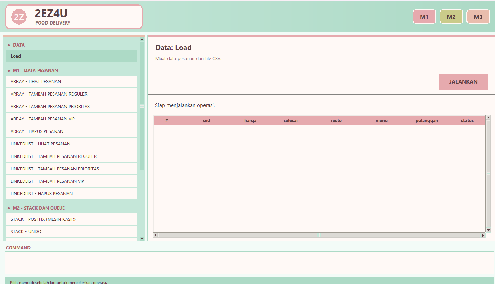

# 2ez4u
2EZ4U Food Delivery

Deskripsi Proyek

2EZ4U Food Delivery merupakan proyek yang basis bahasanya adalah Python dan menerapkan struktur data dan algoritma untuk mengelola pesanan layanan pesan-antar makanan. Proyek ini dikembangkan sebagai penerapan materi Struktur Data dan Algoritma melalui tiga modul utama, yaitu M1, M2, dan M3. Aplikasi dilengkapi dengan antarmuka grafis, yaitu dengan menggunakan Tkinter sehingga pengguna dapat menjalankan operasi struktur data, mengamati perubahan data, serta membandingkan waktu eksekusi algoritma.

Tujuan Proyek

1.Mengimplementasikan struktur data Array dan Linked List untuk mengelola data pesanan.

2.Mengimplementasikan Stack dan Queue untuk simulasi kasir, pengelolaan antrean, serta fitur undo dan redo.

3.Mengimplementasikan algoritma sorting dan searching untuk pengolahan laporan pesanan.

4.Membandingkan kinerja operasi struktur data berdasarkan waktu eksekusi dan jumlah operasi yang dilakukan.

Teknologi yang Digunakan

Bahasa pemrograman: Python

UI: Tkinter

Penyimpanan data: CSV

Editor yang digunakan: Visual Studio Code

Fitur yang ditawarkan

Struktur Folder

Strukdat/

├── Backend/
│   ├── m1_pesanan.py
│   ├── m2_antrean.py
│   └── m3_laporan.py
├── Frontend/
│   └── ui.py
├── data/
│   ├── pesanan.csv
│   └── peta.csv
├── app.py
├── README.md
└── .gitignore

